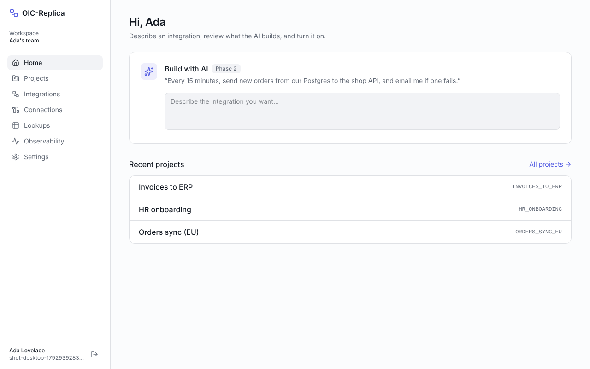

# OIC-Replica

An AI-first integration platform. It does the core of what Oracle Integration
does (connections, flows, mapping, scheduling, monitoring, resubmit), but you
build integrations by describing them in plain English instead of drawing
every step by hand.

> Working name. It gets its own name and brand before launch. It is an
> independent product and is not affiliated with Oracle.

- **AI builder:** say what you want ("every 15 minutes, send new orders from
  Postgres to our shop API and email me on failure"). Claude asks what it
  needs, builds the flow, and you review the changes before they apply.
- **Visual canvas and mapper:** see and fine-tune what the AI built.
- **Every update, everywhere:** live in the app, in Slack, Telegram or email,
  or through [Hermes Agent](https://github.com/NousResearch/hermes-agent) and
  any other MCP client via the built-in MCP server.
- **Self-hostable:** `docker compose up`.

## Status

| phase | | status |
| --- | --- | --- |
| 0 | Foundation: monorepo, auth + workspaces, projects, flow format, CI, Docker | done |
| 1 | Vertical slice: REST connections, run an integration, see every step | next |
| 2 | AI builder | |
| 3 | Visual canvas | |
| 4 | Every update: events, Slack/Telegram, MCP server, Hermes | |
| 5–9 | Mapper, operations, adapters, AI hardening, product | |

Details per phase: [replica/architecture.md](replica/architecture.md#build-order-one-phase-at-a-time).



## Run it

### With Docker (everything)

```bash
cp .env.example .env
# set BETTER_AUTH_SECRET in .env:  openssl rand -hex 32
docker compose up --build
```

Open http://localhost:3000, create an account and a workspace.

### For development

Needs Node 22 and pnpm 10 (`corepack enable`).

```bash
pnpm install
docker compose up -d postgres minio        # or any Postgres 16
cp .env.example apps/web/.env.local        # set BETTER_AUTH_SECRET
pnpm db:migrate
pnpm dev                                   # http://localhost:3000
```

### Checks

```bash
pnpm lint          # Biome
pnpm typecheck
pnpm test          # unit tests; auth tests need TEST_DATABASE_URL
pnpm --filter @oicr/web e2e    # Playwright, desktop + mobile
```

## Layout

```
apps/web               Next.js 16 app: UI, auth routes, (later) API, triggers, AI chat
packages/flow-schema   FlowDoc: the integration format, validator, JSON Schema for the AI
packages/db            Drizzle schema, migrations, org-scoped data access
packages/auth          Better Auth config: email/Google sign-in, workspaces, roles
replica/               recon, feature matrix, architecture, target schema
```

The **FlowDoc** (`packages/flow-schema`) is the heart of it: one typed JSON
format that the canvas edits, the AI proposes changes to, and the engine runs.
Its validator returns errors with a path and a plain-English message, written
so both a person and the AI builder can fix them.

## Plan

| file | what |
| --- | --- |
| [replica/recon.md](replica/recon.md) | what the original does: screens, flows, data model, what's out of scope |
| [replica/features.csv](replica/features.csv) | feature matrix (must / should / could) |
| [replica/architecture.md](replica/architecture.md) | stack, AI builder, Hermes/MCP design, API, build phases |
| [replica/schema.sql](replica/schema.sql) | the target database schema (built up phase by phase) |
