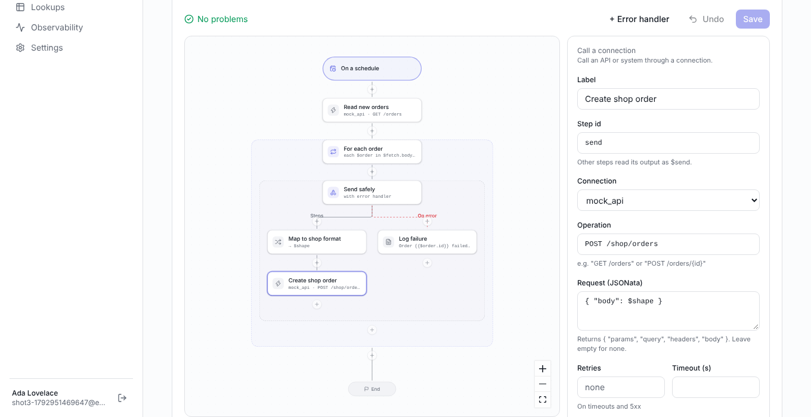

# OIC-Replica

An AI-first integration platform. It does the core of what Oracle Integration
does (connections, flows, mapping, scheduling, monitoring, resubmit), but you
build integrations by describing them in plain English instead of drawing
every step by hand.

> Working name. It gets its own name and brand before launch. It is an
> independent product and is not affiliated with Oracle.

- **AI builder:** say what you want ("every 15 minutes, send new orders from
  Postgres to our shop API and email me on failure"). The AI asks what it
  needs, builds the flow, and you review the changes before they apply.
- **Visual canvas and mapper:** see and fine-tune what the AI built.
- **Semantic catalog:** Oracle Fusion and EBS, NetSuite and SAP S/4HANA objects come mapped to
  business entities (Customer, Invoice...), so `$translate(...)` moves records between them
  without field-by-field maps. Paste a sample of any other system and the AI proposes its bindings
  for you to review.
- **Every update, everywhere:** live in the app, in Slack, Telegram or email,
  or through [Hermes Agent](https://github.com/NousResearch/hermes-agent) and
  any other MCP client via the built-in MCP server.
- **Self-hostable:** `docker compose up`.
- **Built for multi-tenant production:** each workspace's data is isolated by Postgres row-level
  security; customer credentials live in HashiCorp Vault, never in the database; every run, step,
  connection call and AI turn is traced with OpenTelemetry. Trigger calls are served by a separate,
  stateless stream engine with per-tenant limits. See
  [docs/platform-architecture.md](docs/platform-architecture.md) for where this is going (batch
  engine, ERP connectors).

## Status

| phase | | status |
| --- | --- | --- |
| 0 | Foundation: monorepo, auth + workspaces, projects, flow format, CI, Docker | done |
| 1 | Vertical slice: REST connections, engine, worker, schedules, HTTP triggers, runs with every step | done |
| 2 | AI builder: describe it in English, answer questions, review the diff, accept | done |
| 3 | Visual canvas: build and edit on a diagram, run replay, AI changes on the canvas | done |
| 4 | Every update: live activity, Slack/Telegram/email/webhook, API keys, public API, MCP server, Hermes | done |
| 5 | Mapper and lookups: map fields visually, functions, test with samples, lookups from CSV | done |
| 6 | Operations: errors, resubmit, dashboard, AI "explain this failure" | next |
| 7–9 | Adapters, AI hardening, product | |

Details per phase: [replica/architecture.md](replica/architecture.md#build-order-one-phase-at-a-time).



## Run it

### With Docker (everything)

```bash
cp .env.example .env
# set BETTER_AUTH_SECRET (any long random string, e.g. openssl rand -hex 32)
docker compose up --build
```

This starts Postgres, a local Vault (initialised and unsealed automatically; credentials are
stored there), the web app, the stream engine (trigger URLs), the worker and the batch engine
(pipelines). Set `ALLOW_PRIVATE_NETWORK=true` in `.env` to reach databases on your own network. Open http://localhost:3000, create an account and a
workspace. Then:

1. **Connections → New connection**: a REST API with its base URL and credentials. Press **Test**.
2. **Integrations → New**: pick "On a schedule" or "When called". Start from a template or write the
   definition, **Save**, set a schedule if needed, **Activate**.
3. **Run now** (or call the trigger URL with its token) and open the run to see every step.

Or skip step 2: on **Home**, describe the integration in plain English ("every 15 minutes, send new
orders from the orders API to the shop and email me if one fails"). The AI builder asks what it
needs, drafts missing connections (you add the credentials), and shows the integration with a
step-by-step diff. Nothing is created until you press **Create integration**. On any integration,
**Edit with AI** changes it by instruction the same way.

The AI builder runs on **Gemini** (default), **Claude** or **GPT**. Set `GEMINI_API_KEY`, or
`ANTHROPIC_API_KEY` / `OPENAI_API_KEY`; with more than one key, `AI_PROVIDER` picks
(`gemini`, `anthropic`, `openai`). `GEMINI_MODEL`, `ANTHROPIC_MODEL`, `OPENAI_MODEL` (or
`AI_MODEL` for the active one) and `AI_EFFORT` tune it. The chat shows which model is building.

### Mapping data

Open a **Map data** step (or **Map the request** on a call, **Map the response** on a reply) to get
the mapper: what the step can read on the left (the trigger, earlier steps, loop items), the fields
it produces in the middle, functions and a test on the right.

- Click a source field to map it into the selected target field, or into a new one. Drag works too.
- **List** maps a list item by item: pick the source list, then the item's fields (paths become
  relative to the item).
- Functions (text, numbers, dates, logic, lists, your lookups) wrap the selected field.
- Sample data comes from the latest run, or paste one per source. **Run test** shows the result.
- **Target from sample** sets the expected output; required fields that are not mapped are flagged.
- **Code** shows the JSONata behind it; anything the field view cannot show stays editable as code.

**Lookups** translate values between systems (country codes, status codes). Make one under
**Lookups** (type it in or import a CSV, first line = domain names) and use it in any expression:
`$lookupValue("countries", "shop", $order.country, "erp", "XX")`. Lookups used by an active
integration cannot be deleted or renamed.

### Semantic catalog

**Semantic catalog** lists business entities (Customer, Supplier, Item, SalesOrder, PurchaseOrder,
Invoice, SupplierInvoice, Payment, JournalEntry) and how each system's objects map to them, field
by field: Oracle Fusion REST resources, Oracle EBS tables, NetSuite records and SAP S/4HANA OData
entities come bound. Expressions use them by system and object:

```
$toSemantic($get.body.items, "oracle-ebs", "HZ_CUST_ACCOUNTS")   → Customer records
$fromSemantic($customer, "netsuite", "customer")                  → a NetSuite customer
$translate($trigger.d.results, "sap-s4hana", "A_SalesOrder", "oracle-ebs", "OE_ORDER_HEADERS_ALL")
```

Values are normalised on the way in (numbers, booleans from Y/N or X flags, ISO dates from
`/Date(ms)/`) and written in each system's format on the way out.

- **Bind a system object** → paste a sample (JSON records or an API response, CSV, or one column
  per line). The AI proposes the entity and a binding per field, with its confidence and why.
  Confident bindings that do not conflict apply at once; you approve, correct or reject the rest.
  Example values can be withheld from the AI, and are never stored.
- Edit, unbind or reset any binding, add attributes to an entity, or create entities of your own.
- Activation compiles the bindings an integration uses into its execution plan: runs never read
  the catalog or call a model. When bindings change later, the integration page says so;
  activate it again to use them.
- The AI builder knows the catalog and prefers these functions for ERP-to-ERP flows. Read it over
  the API (`GET /api/v1/catalog`) or MCP (`semantic_catalog`).

### Databases and batch loads

**Connections → New connection → Database** connects PostgreSQL, MySQL or Oracle (including
E-Business Suite; no Oracle client to install). In a flow:

- **Call a connection** with `query` (`{ "sql": "select … where id = :id", "params": { "id": 1 } }`,
  at most `maxRows` rows), `execute`, `insert` or `upsert` (`{ "rows": [...] }`).
- **Batch pipeline** for moving many records: it reads a table or query in chunks by a unique
  key, keeps and reshapes each record with JSONata (`$record`; `$translate` and lookups work),
  and upserts or inserts chunks into the target. It runs on the batch engine with transforms on
  worker threads, so memory stays flat however large the table is. Every chunk is checkpointed:
  if the engine stops, the run resumes where it was. Records the target refuses are set aside
  (shown on the run page) instead of failing the run, up to the step's limit.

```json
{ "id": "load", "type": "pipeline",
  "source": { "connection": "ebs", "operation": "read",
              "config": { "table": "AR.HZ_CUST_ACCOUNTS", "where": "LAST_UPDATE_DATE > :since", "key": "CUST_ACCOUNT_ID" },
              "params": "{ \"since\": $trigger.scheduledFor }" },
  "transform": "$translate($record, \"oracle-ebs\", \"HZ_CUST_ACCOUNTS\", \"netsuite\", \"customer\")",
  "target": { "connection": "staging", "operation": "upsert", "config": { "table": "ns_customers", "key": "entityId" } },
  "chunkSize": 1000 }
```

### Every update

Everything that happens (runs, activations, AI proposals and questions, connection tests) is an
event. You see it:

- **Live in the app**: **Activity**, toasts for failures, pages that refresh themselves.
- **In Slack, Telegram, email or any webhook**: **Settings → Notifications**. Pick "every update",
  "only what needs attention", "every run" or "only failed runs". Failed sends are retried
  (1 min, 5 min, 30 min, 2 h).
- **Through Hermes Agent**: **Settings → Hermes Agent** walks you through it. Hermes gets every
  update pushed to your chat over a signed webhook, and tools over MCP so you can ask "what failed
  today and why?" or "run the orders sync" from your phone. See [docs/hermes.md](docs/hermes.md).
- **From scripts**: create a key in **Settings → API keys** and call `/api/v1` (below) or the MCP
  server at `/mcp`.

| API (Bearer key) | |
| --- | --- |
| `GET /api/v1/events?since_id=N&types=…` | updates after a cursor, oldest first; returns `next_since_id` |
| `GET /api/v1/projects`, `/integrations`, `/integrations/:id`, `/lookups` | what exists |
| `GET /api/v1/runs?status=failed`, `/runs/:id` | runs, with step activity |
| `POST /api/v1/integrations/:id/activate`, `/deactivate`, `/runs` | needs the **operate** scope |

### For development

Needs Node 22 and pnpm 10 (`corepack enable`).

```bash
pnpm install
docker compose up -d postgres              # or any Postgres 16
cp .env.example .env                       # set BETTER_AUTH_SECRET and SECRETS_KEY (dev credential store)
set -a; . ./.env; set +a
pnpm db:migrate
pnpm dev                                   # web on :3000, stream engine on :3001, worker, batch engine
```

### Checks

```bash
pnpm lint          # Biome
pnpm typecheck
pnpm test          # unit tests; DB tests need TEST_DATABASE_URL, real-Vault tests VAULT_TEST_ADDR,
                   # live database adapter tests ADAPTER_TEST_POSTGRES / _MYSQL / _ORACLE (URLs)
pnpm --filter @oicr/web e2e    # Playwright: starts a mock API, the web app, the stream engine and the worker;
                               # the AI builder runs on recorded turns (no API key needed)
pnpm --filter @oicr/ai eval    # AI builder quality against the configured provider (needs its key;
                               # uses real tokens)
```

## Layout

```
apps/web               Next.js 16 app: UI, auth, AI chat, API (/api/v1), MCP (/mcp); forwards /t/... to the stream engine
apps/stream            stream engine: serves trigger URLs (/t/...), runs sync flows inline, queues async ones
apps/worker            runs queued integrations, fires schedules, delivers notifications, reaps crashed runs
apps/batch             batch engine: runs pipelines (chunks, worker-thread transforms, checkpoints, resume)
packages/flow-schema   FlowDoc: the integration format, validator, JSON Schema for the AI
packages/engine        runs a FlowDoc step by step (pure; all I/O injected)
packages/adapters      adapter interface, REST and database (PostgreSQL, MySQL, Oracle) adapters, SSRF protection
packages/semantic      semantic catalog: entities, ERP bindings, graph, compiler, runtime functions, AI proposal checks
packages/batch         pipeline runner (backpressure, ordered checkpoints, rejects) and transform worker pool
packages/runtime       engine + adapters + database: execute runs, queue (pg-boss), triggers
packages/ai            the AI builder: tool-use loop, providers (Gemini, Claude, GPT), tools, prompt, evals
packages/platform      retry policy (backoff, jitter, Retry-After, deadlines), OpenTelemetry helpers + bootstrap
packages/vault         secret store: HashiCorp Vault KV v2 (token / AppRole / Kubernetes auth), cache
packages/notify        sends updates to Slack, Telegram, email and signed webhooks, with retries
packages/db            Drizzle schema, migrations, org-scoped data access, secret store wiring
packages/auth          Better Auth config: email/Google sign-in, workspaces, roles
replica/               recon, feature matrix, architecture, target schema
```

The **FlowDoc** (`packages/flow-schema`) is the heart of it: one typed JSON
format that the canvas edits, the AI proposes changes to, and the engine runs.
Its validator returns errors with a path and a plain-English message, written
so both a person and the AI builder can fix them.

## Plan

| file | what |
| --- | --- |
| [replica/recon.md](replica/recon.md) | what the original does: screens, flows, data model, what's out of scope |
| [replica/features.csv](replica/features.csv) | feature matrix (must / should / could) |
| [replica/architecture.md](replica/architecture.md) | stack, AI builder, Hermes/MCP design, API, build phases |
| [replica/schema.sql](replica/schema.sql) | the target database schema (built up phase by phase) |
